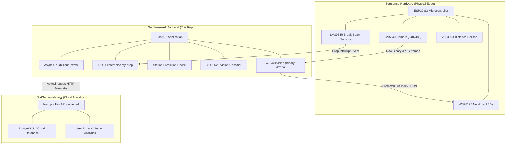
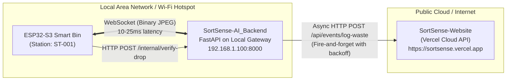
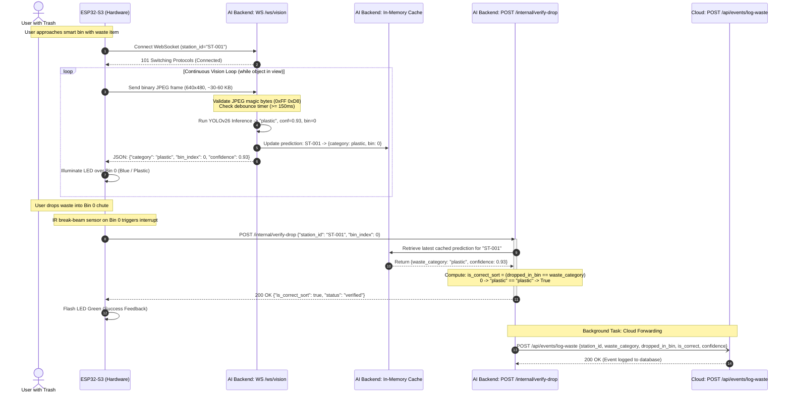
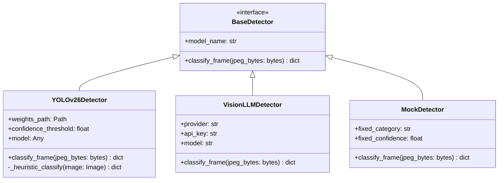

# SortSense-AI_Backend — Technical Architecture & Workflow Guide

An in-depth, end-to-end technical explanation of the **SortSense-AI_Backend**, from the genesis of the system architecture to granular implementation details of the vision inference engine, WebSocket streaming pipeline, drop verification logic, and cloud telemetry.

---

## Table of Contents
1. [From the Beginning: System Origin & Architecture](#1-from-the-beginning-system-origin--architecture)
   - [The Problem Statement](#the-problem-statement)
   - [The Tri-Repo Ecosystem](#the-tri-repo-ecosystem)
   - [Why a Dedicated Local LAN AI Server?](#why-a-dedicated-local-lan-ai-server)
2. [End-to-End System Workflow](#2-end-to-end-system-workflow)
   - [System Topology](#system-topology)
   - [Complete Execution Sequence](#complete-execution-sequence)
   - [Phase 1: Real-Time Vision Streaming & Inference](#phase-1-real-time-vision-streaming--inference)
   - [Phase 2: In-Memory Station Prediction Caching](#phase-2-in-memory-station-prediction-caching)
   - [Phase 3: Drop Event Verification](#phase-3-drop-event-verification)
   - [Phase 4: Asynchronous Cloud Telemetry Dispatch](#phase-4-asynchronous-cloud-telemetry-dispatch)
3. [Deep-Dive Technical Details](#3-deep-dive-technical-details)
   - [FastAPI Server Core & Lifespan Management (`app/main.py`)](#fastapi-server-core--lifespan-management-appmainpy)
   - [Binary WebSocket Protocol & Debouncing Engine](#binary-websocket-protocol--debouncing-engine)
   - [Pluggable Vision Engine Architecture (`app/detector.py`)](#pluggable-vision-engine-architecture-appdetectorpy)
   - [Why YOLOv26? (Edge Object Detection)](#why-yolov26-edge-object-detection)
   - [Standardized Bin Mapping & Schemas (`app/schemas.py`)](#standardized-bin-mapping--schemas-appschemaspy)
   - [Async Cloud Client & Resilient Telemetry (`app/cloud_client.py`)](#async-cloud-client--resilient-telemetry-appcloud_clientpy)
   - [Fine-Tuning & Dataset Pipeline (`scripts/fine_tune_prep.py`)](#fine-tuning--dataset-pipeline-scriptsfine_tune_preppy)
   - [Containerization & Production Deployment](#containerization--production-deployment)
   - [CI/CD Automation Pipeline](#cicd-automation-pipeline)
   - [Test Suite & Quality Verification](#test-suite--quality-verification)
4. [API Contract Specifications](#4-api-contract-specifications)
5. [Configuration & Deployment Guide](#5-configuration--deployment-guide)

---

## 1. From the Beginning: System Origin & Architecture

### The Problem Statement
Waste contamination in public recycling receptacles leads to significant recycling failure rates worldwide. Users frequently discard recyclable materials into general waste or place non-recyclables into specialized bins due to ambiguous packaging, lack of clear signage, or inattention.

**SortSense** solves this at the point of disposal using computer vision and edge guidance. As a user approaches the smart bin and holds up an item, the bin identifies the waste category in real-time, illuminates the correct bin chute using high-visibility LEDs, validates that the user deposited the item into the designated chute using infrared break-beam sensors, and logs the sorting event to a cloud analytics dashboard.

---

### The Tri-Repo Ecosystem
The SortSense architecture is distributed across three specialized repositories designed to work in synergy:



1. **[SortSense-Hardware](https://github.com/SortSense/SortSense-Hardware)**:
   - Built on the ESP32-S3 with 8MB PSRAM.
   - Manages an OV5640 camera sensor over DVP/SCCB at 640×480 resolution.
   - Operates 4 infrared (IR) break-beam optical switches mounted inside each bin chute.
   - Drives individually addressable WS2812B NeoPixel RGB LEDs to visually guide the user.
   - Communicates over Wi-Fi within the local LAN.

2. **[SortSense-AI_Backend](https://github.com/SortSense/SortSense-AI_Backend) (This Repository)**:
   - Python 3.11+ high-concurrency FastAPI server running on a local LAN machine or edge gateway (laptop, mini PC, or local Docker container).
   - Ingests real-time raw JPEG frames from the ESP32-S3 over a persistent WebSocket (`/ws/vision`).
   - Runs neural vision inference using **YOLOv26** (or fallback multimodal Vision LLM).
   - Immediately returns the predicted bin index to drive the hardware LEDs.
   - Caches the prediction per station.
   - Receives the drop notification (`/internal/verify-drop`) when an IR sensor triggers, verifies whether the drop matched the AI prediction, and asynchronously forwards telemetry to the cloud.

3. **[SortSense-Website](https://github.com/SortSense/SortSense-Website)**:
   - Hosted on Vercel (Next.js / Cloud API).
   - Collects sorting metrics, maintains historical trends, calculates recycling accuracy scores, and displays administrative dashboards.

---

### Why a Dedicated Local LAN AI Server?
A foundational architectural question is: *Why not run inference directly on the ESP32, or stream directly from the ESP32 to the cloud?*

1. **ESP32-S3 Compute Limitations:**
   While the ESP32-S3 includes vector instructions for basic neural networks (ESP-NN), running modern high-accuracy object detection models (such as YOLOv26 with hundreds of channels and anchor-free heads) exceeds the memory bandwidth and compute budget of an MCU. Running a large model on the ESP32 causes frame rates to drop below 0.5 FPS, creating unacceptable user latency.
2. **Cloud Serverless Constraints (Vercel):**
   Vercel's serverless architecture operates on transient, stateless execution contexts with strict execution time limits. Serverless environments **cannot maintain persistent, low-latency WebSocket connections** with streaming hardware clients.
3. **Bandwidth & Latency Optimization:**
   Transmitting continuous 640×480 JPEG streams over the public internet to a remote cloud server introduces high jitter, variable round-trip latency (150ms–500ms+), and heavy WAN data usage.
4. **The Local LAN Solution:**
   Placing `SortSense-AI_Backend` on the local LAN allows the ESP32-S3 to stream over high-throughput, low-latency local Wi-Fi (<10ms network round-trip). The local server runs real-time edge AI inference and guides the user via the LEDs instantaneously. Once a drop occurs, the server sends a single, compact telemetry payload to the cloud over standard HTTPS.

---

## 2. End-to-End System Workflow

### System Topology
The following diagram demonstrates the communication boundaries between LAN and WAN:



---

### Complete Execution Sequence



---

### Detailed Workflow Phases

#### Phase 1: Real-Time Vision Streaming & Inference
1. The ESP32-S3 boots and opens a persistent duplex WebSocket connection to:
   `ws://<SERVER_LAN_IP>:8000/ws/vision?station_id=ST-001`
2. When the user approaches and the Time-of-Flight sensor detects an object in range, the camera initiates capture.
3. The camera buffer captures a **640 × 480 JPEG frame** and pushes the binary stream directly across the WebSocket.
4. **Debounce Gate:** The server compares the arrival timestamp against the last processed timestamp for that station:
   $$\Delta t = t_{\text{current}} - t_{\text{last\_processed}}$$
   - If $\Delta t < 150\text{ ms}$, the server skips redundant heavy inference and immediately returns the cached prediction.
   - If $\Delta t \ge 150\text{ ms}$, the server passes the frame to `app/detector.py`.
5. **Frame Validation:** Magic bytes are inspected:
   - Byte 0: `0xFF`
   - Byte 1: `0xD8`
   - Byte -2: `0xFF`
   - Byte -1: `0xD9`
6. **Inference Execution:** YOLOv26 extracts features, performs anchor-free bounding and classification, and returns the highest confidence detection.
7. **JSON Response:** The server sends a structured JSON payload:
   ```json
   {
     "category": "plastic",
     "bin_index": 0,
     "confidence": 0.93
   }
   ```
8. The ESP32 parses `bin_index: 0` and illuminates the corresponding NeoPixel LED to guide the user.

#### Phase 2: In-Memory Station Prediction Caching
Simultaneously with sending the response, the server stores the prediction in an in-memory dictionary:
```python
station_prediction_cache[station_id] = {
    "category": category,
    "bin_index": bin_index,
    "confidence": confidence,
    "timestamp": time.time(),
}
```
This cache bridges the asynchronous gap between what the camera saw before the drop and what the IR sensor detects during the drop.

#### Phase 3: Drop Event Verification
1. The user drops the waste into one of the 4 bin chutes.
2. The physical object breaks the infrared beam of the chute's LM393 IR break-beam sensor.
3. The ESP32 hardware interrupt captures the event and sends an HTTP POST request:
   - **Endpoint:** `POST http://<SERVER_LAN_IP>:8000/internal/verify-drop`
   - **Payload:**
     ```json
     {
       "station_id": "ST-001",
       "bin_index": 0
     }
     ```
4. The server maps `bin_index: 0` to its standardized enum: `"plastic"`.
5. It queries `station_prediction_cache` for `"ST-001"`.
6. It evaluates correctness:
   $$\text{is\_correct\_sort} = (\text{dropped\_category} == \text{predicted\_category})$$
7. The server responds immediately to the ESP32:
   ```json
   {
     "station_id": "ST-001",
     "waste_category": "plastic",
     "dropped_in_bin": "plastic",
     "confidence": 0.93,
     "is_correct_sort": true,
     "status": "verified",
     "cloud_forwarded": true
   }
   ```
8. The ESP32 flashes green for a correct sort or amber/red for an incorrect sort, providing instant user feedback.

#### Phase 4: Asynchronous Cloud Telemetry Dispatch
1. The verification endpoint enqueues a background task via FastAPI's `BackgroundTasks`.
2. The `CloudClient` instance builds the telemetry payload:
   ```json
   {
     "station_id": "ST-001",
     "waste_category": "plastic",
     "dropped_in_bin": "plastic",
     "confidence": 0.93,
     "is_correct_sort": true
   }
   ```
3. The client issues an asynchronous HTTP POST to:
   `POST {CLOUD_API_URL}/api/events/log-waste`
4. If network congestion or cloud unavailability occurs, the client automatically retries up to 3 times with exponential backoff ($1\text{s}, 2\text{s}, 4\text{s}$), ensuring reliable delivery without stalling the local station.

---

## 3. Deep-Dive Technical Details

### FastAPI Server Core & Lifespan Management (`app/main.py`)
`app/main.py` is the application entrypoint. It utilizes modern ASGI lifespan context management rather than deprecated startup/shutdown events:

```python
@asynccontextmanager
async def lifespan(app: FastAPI):
    # STARTUP:
    # 1. Initialize detector backend (YOLOv26 / VLM / Mock)
    # 2. Warm up inference engine
    # 3. Initialize persistent async httpx client
    yield
    # SHUTDOWN:
    # 1. Close persistent HTTP connection pools
    # 2. Flush station caches and release hardware handles
```

#### Key Architecture Components in `main.py`:
- **`station_prediction_cache: dict[str, dict]`**: Stores the latest prediction keyed by `station_id`.
- **`station_connections: dict[str, set[WebSocket]]`**: Tracks active client connections per station to support multi-station deployments.
- **Debounce Registry**: Stores per-station timestamps to throttle high-frequency camera frames.

---

### Binary WebSocket Protocol & Debouncing Engine
The ESP32 camera streaming handler (`/ws/vision`) uses binary WebSocket frames to minimize protocol overhead:

1. **Protocol:** Binary WebSocket frame (Opcode 0x2).
2. **Input Validation:**
   - Empty payload check ($< 10\text{ bytes}$).
   - JPEG Header inspection (`0xFF 0xD8`).
   - Frame length bounds checking to reject truncated frames.
3. **Adaptive Debouncing Algorithm:**
   ```python
   now = time.time()
   last_time = station_last_frame_time.get(station_id, 0.0)
   if now - last_time < settings.frame_debounce_interval:
       # Return cached prediction immediately to prevent model congestion
       await websocket.send_text(cached_result.model_dump_json())
       continue
   ```
4. **Exception Handling:** Handles standard `WebSocketDisconnect` as well as Starlette's `RuntimeError` (`"WebSocket is not connected"`) to ensure clean disconnects when the ESP32 reboots or loses Wi-Fi.

---

### Pluggable Vision Engine Architecture (`app/detector.py`)
Model inference is isolated behind a clean abstraction layer:



#### Classifier Interface Contract:
```python
def classify_frame(jpeg_bytes: bytes) -> dict:
    """
    Returns:
    {
        "category": "plastic" | "paper" | "metal" | "general" | "none",
        "bin_index": 0 | 1 | 2 | 3 | -1,
        "confidence": float (0.0 to 1.0)
    }
    """
```

- **Thread-Safe Global Singleton:** The detector instance is initialized at startup and accessed via `get_detector()` and `set_detector()`.
- **Heuristic Bootstrap Fallback:** In `YOLOv26Detector`, if model weight files (`weights/yolo26n.pt`) are still downloading or undergoing fine-tuning, the detector seamlessly falls back to a deterministic, NumPy-accelerated color/brightness/texture heuristic. This allows hardware engineers to test the full loop without waiting for training completion.

---

### Why YOLOv26? (Edge Object Detection)
The selection of YOLOv26 is driven by specific edge constraints:

1. **Sub-25ms Inference Time:** YOLOv26's optimized backbone delivers high frame rates on standard CPU and edge NPU hardware.
2. **Anchor-Free Architecture:** Recyclable waste items exhibit extreme deformability (crushed soda cans, crumpled paper, torn cardboard boxes). Anchor-free regression heads handle irregular bounding boxes significantly better than rigid anchor-based systems.
3. **Precision on Low-Resolution Streams:** Operating directly on 640×480 inputs, the model maintains high mAP without requiring heavy bicubic upsampling.
4. **Multi-Class Output Separation:** Accurately separates ambiguous materials, such as metal-coated plastics or shiny paper.

---

### Standardized Bin Mapping & Schemas (`app/schemas.py`)
All components adhere to a strict enum and index contract:

| Bin Index | Category String | Description / Typical Items |
|:---------:|:---------------:|:----------------------------|
| `0` | `"plastic"` | Water bottles, PET containers, wrappers, caps |
| `1` | `"paper"` | Cardboard, office paper, magazines, cartons |
| `2` | `"metal"` | Beverage cans, tin cans, foil containers |
| `3` | `"general"` | Food scraps, organic waste, styrofoam, contaminated items |
| `-1` | `"none"` | Empty background, no waste in frame, low confidence |

#### Pydantic Data Models:
- `VisionPredictionResponse`: Sent to the ESP32 over WebSocket.
- `VerifyDropRequest`: Received from the ESP32 upon IR break-beam trigger.
- `VerifyDropResponse`: Returned to the ESP32 with verification outcome.
- `CloudTelemetryPayload`: Dispatched to `SortSense-Website`.
- `HealthResponse`: System operational status and active connections.

---

### Async Cloud Client & Resilient Telemetry (`app/cloud_client.py`)
Communication with the cloud must never block local hardware operations. The `CloudClient` provides:

- **Persistent Connection Pool:** Uses a shared `httpx.AsyncClient` instance across requests to eliminate TLS handshake overhead.
- **Exponential Backoff:** If the cloud responds with HTTP 5xx or experiences a connection timeout, retries are spaced exponentially:
  $$\text{delay} = \text{base\_delay} \times 2^{\text{attempt}}$$
- **Fail-Safe Design:** If the cloud is completely unreachable, errors are logged without interrupting the local bin's operational loop.

---

### Fine-Tuning & Dataset Pipeline (`scripts/fine_tune_prep.py`)
A production-ready pipeline script facilitates training custom YOLOv26 models on new waste datasets:

1. **Directory Structure Standardization:**
   ```
   dataset/
   ├── images/
   │   ├── train/
   │   └── val/
   └── labels/
       ├── train/
       └── val/
   ```
2. **Automated `data.yaml` Generation:** Exports class indices matching the `WasteCategory` enum.
3. **Label Verification & Geometry Checks:** Validates normalized bounding coordinates ($0.0 \le x, y, w, h \le 1.0$) and rejects corrupted label files.
4. **Training Orchestration:** Integrates directly with Ultralytics training routines:
   ```bash
   python scripts/fine_tune_prep.py --data-dir ./data/waste_dataset --epochs 50 --batch 16
   ```

---

### Containerization & Production Deployment

#### Multi-Stage `Dockerfile`
The Docker build utilizes a multi-stage pattern to minimize image size and attack surface:

- **Stage 1 (Builder):** Installs build tools, compiles C extensions (Pillow, NumPy), and wheels dependencies.
- **Stage 2 (Runtime):** Uses `python:3.11-slim`, copies wheels, sets up a non-root system user (`sortsense:sortsense`), and defines an explicit `HEALTHCHECK`:
  ```dockerfile
  HEALTHCHECK --interval=30s --timeout=5s --start-period=5s --retries=3 \
      CMD curl -f http://localhost:8000/health || exit 1
  ```

#### Docker Compose (`docker-compose.yml`)
Enables one-command deployment on local LAN gateways with host port mapping and environment injection:
```bash
docker compose up -d
```

---

### CI/CD Automation Pipeline (`.github/workflows/ci.yml`)
Every push and pull request triggers an automated GitHub Actions workflow:

1. **Code Quality Stage:** Runs `ruff check .` and `ruff format --check .` to enforce PEP 8 compliance and import sorting.
2. **Matrix Test Stage:** Executes the full 54-test suite across Python **3.11**, **3.12**, and **3.13**.
3. **Coverage Verification:** Verifies branch and line coverage using `pytest-cov`.
4. **Docker Build Verification:** Builds the Docker container to ensure Dockerfile integrity.

---

### Test Suite & Quality Verification (`tests/`)
The repository includes **54 automated unit and integration tests** across 6 test modules:

```
tests/
├── test_schemas.py           # 11 tests: enum validation, bin mapping, Pydantic contracts
├── test_detector.py          # 18 tests: JPEG headers, YOLO26n inference, center ROI, smoothing, fallbacks
├── test_endpoints.py         # 11 tests: /health, /internal/verify-drop, /api/telemetry/fill-levels
├── test_websocket.py         #  5 tests: WS binary frame ingestion, debounce, smoothing, reconnects
├── test_cloud_client.py      #  5 tests: HTTP dispatch, fill-levels forwarding, retries, error handling
└── test_fine_tune_prep.py    #  4 tests: dataset validation, YAML generation, label checks
```

---

## 4. API Contract Specifications

### 1. `WS /ws/vision` (ESP32 Camera Stream)
- **Protocol:** WebSocket (Binary input, Text JSON output)
- **Query Parameter:** `station_id` (string, e.g. `ST-001`)
- **Incoming Frame:** Binary JPEG payload (640 × 480 pixels)
- **Outgoing JSON:**
  ```json
  {
    "category": "plastic",
    "bin_index": 0,
    "confidence": 0.93
  }
  ```

---

### 2. `POST /internal/verify-drop` (IR Break-Beam Trigger)
- **Headers:** `Content-Type: application/json`
- **Request Body:**
  ```json
  {
    "station_id": "ST-001",
    "bin_index": 0
  }
  ```
- **Response Body (200 OK):**
  ```json
  {
    "station_id": "ST-001",
    "waste_category": "plastic",
    "dropped_in_bin": "plastic",
    "confidence": 0.93,
    "is_correct_sort": true,
    "status": "verified",
    "cloud_forwarded": true
  }
  ```

---

### 3. `POST {CLOUD_API_URL}/api/events/log-waste` (Cloud Telemetry)
- **Headers:** `Content-Type: application/json`
- **Request Body:**
  ```json
  {
    "station_id": "ST-001",
    "waste_category": "plastic",
    "dropped_in_bin": "plastic",
    "confidence": 0.93,
    "is_correct_sort": true
  }
  ```

---

### 4. `POST /api/telemetry/fill-levels` (ToF Fill-Level Ingestion & Cloud Forwarding)
- **Headers:** `Content-Type: application/json`
- **Request Body:**
  ```json
  {
    "station_id": "ST-001",
    "fill_levels": {
      "plastic": 72.0,
      "paper": 35.0,
      "metal": 15.0,
      "general": 0.0
    }
  }
  ```
- **Behavior:** Logs live compartment fill bars in the LAN console and asynchronously forwards the payload to `POST {CLOUD_API_URL}/api/telemetry/fill-levels`.

---

### 5. `GET /health` (Service Monitoring)
- **Response Body (200 OK):**
  ```json
  {
    "status": "healthy",
    "service": "SortSense-AI_Backend",
    "version": "1.0.0",
    "model_backend": "yolov26",
    "active_station_count": 1
  }
  ```

---

## 5. Configuration & Deployment Guide

### Environment Variables (`.env`)
| Variable | Default Value | Description |
|:---|:---:|:---|
| `HOST` | `0.0.0.0` | Bind IP address |
| `PORT` | `8000` | Bind port number |
| `DEBUG` | `false` | Enable verbose debugging and auto-reload |
| `MODEL_BACKEND` | `yolov26` | Active vision engine: `yolov26`, `vlm`, `mock` |
| `MODEL_WEIGHTS_PATH` | `weights/yolo26n.pt` | Path to trained model weights |
| `CONFIDENCE_THRESHOLD` | `0.50` | Minimum confidence score to register a detection |
| `FOCUS_CENTER_ROI` | `true` | Restrict detections to the central handheld scan zone |
| `FRAME_DEBOUNCE_INTERVAL` | `0.15` | Frame throttle window in seconds (150ms) |
| `SMOOTHING_WINDOW_SIZE` | `5` | Majority-vote smoothing window across recent frames |
| `CLOUD_API_URL` | `http://localhost:3000` | Base URL of the SortSense-Website cloud service |
| `CLOUD_API_TIMEOUT` | `5.0` | HTTP request timeout for cloud telemetry |
| `CLOUD_API_MAX_RETRIES` | `3` | Retry count with exponential backoff for cloud dispatch |

---

### Quickstart Execution

#### Option A: Running with Docker Compose (Recommended)
```bash
# Clone the repository
git clone https://github.com/SortSense/SortSense-AI_Backend.git
cd SortSense-AI_Backend

# Launch the containerized backend
docker compose up --build -d

# Verify health status
curl http://localhost:8000/health
```

#### Option B: Running Locally with Python Virtual Environment
```bash
# 1. Create and activate virtual environment
python -m venv .venv
source .venv/bin/activate    # On Windows: .venv\Scripts\activate

# 2. Install core dependencies + Ultralytics for trained weights/yolo26n.pt
pip install -r requirements.txt
pip install ultralytics

# 3. Configure environment
cp .env.example .env

# 4. Start the server
uvicorn app.main:app --host 0.0.0.0 --port 8000 --reload
```

#### Option C: Executing the Test Suite
```bash
# Run all 54 tests with coverage report
pytest -v --cov=app --cov=scripts

# Validate code formatting
ruff check .
ruff format --check .
```
