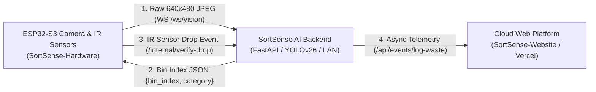

# SortSense-AI_Backend — Architecture & System Explanation

## 1. Executive Summary & System Role

**SortSense** is an automated, smart waste sorting ecosystem consisting of three synchronized repositories:
1. **[SortSense-Hardware](https://github.com/SortSense/SortSense-Hardware)**: ESP32-S3 microcontroller managing OV5640 camera acquisition (640×480 @ 20MHz), VL53L0X Time-of-Flight distance sensors, LM393 IR break-beam sensors on waste drop chutes, and WS2812B NeoPixel LED status indicators.
2. **SortSense-AI_Backend (This Repo)**: High-speed, local LAN FastAPI vision & AI inference server. Because serverless cloud platforms like Vercel cannot maintain persistent low-latency WebSockets, this local server bridges the edge device and the cloud.
3. **[SortSense-Website](https://github.com/SortSense/SortSense-Website)**: Central Next.js & FastAPI cloud web dashboard hosted on Vercel for analytics, user stats, and system event logging.



---

## 2. Core Workflow & Step-by-Step Lifecycle

### Step 1: Real-Time Frame Streaming (`WS /ws/vision`)
- The ESP32-S3 opens a persistent WebSocket connection to `ws://<SERVER_IP>:8000/ws/vision?station_id=ST-001`.
- When an object enters the camera view, the ESP32 captures a **640 × 480 JPEG** frame and transmits the raw binary bytes over the WebSocket.
- The server validates the JPEG magic bytes (`0xFF 0xD8`), downsamples/analyzes the frame, and runs inference using the **YOLOv26** vision engine (or configured VLM / Vision LLM).
- **Debouncing & Throttling:** Incoming frames are throttled at a default interval of `150ms` (`FRAME_DEBOUNCE_INTERVAL=0.15`). If frames arrive faster than this window, the previous inference result is served immediately, preventing network buffer bloat and LED flicker.
- The server sends a fast text JSON response back to the ESP32:
  ```json
  {
    "category": "plastic",
    "bin_index": 0,
    "confidence": 0.91
  }
  ```
- The ESP32 reads `bin_index` and illuminates the corresponding LED over the designated bin chute to guide the user.

### Step 2: In-Memory Station Prediction Caching
- Concurrently with replying to the WebSocket, the server caches the most recent prediction into an in-memory dictionary keyed by `station_id`:
  ```python
  station_prediction_cache["ST-001"] = {
      "category": "plastic",
      "bin_index": 0,
      "confidence": 0.91,
      "timestamp": 1700000000.0,
  }
  ```

### Step 3: Physical Drop Verification (`POST /internal/verify-drop`)
- When the user drops the item into a bin chute, the hardware IR break-beam sensor fires an interrupt.
- The ESP32 calls `POST http://<SERVER_IP>:8000/internal/verify-drop`:
  ```json
  {
    "station_id": "ST-001",
    "bin_index": 0
  }
  ```
- The server performs deterministic verification:
  1. Translates `bin_index` (`0`) to category name (`"plastic"`).
  2. Queries `station_prediction_cache` for `ST-001`.
  3. Evaluates `is_correct_sort = (dropped_in_bin == waste_category)`.
  4. Returns the verification status immediately to the ESP32:
     ```json
     {
       "station_id": "ST-001",
       "waste_category": "plastic",
       "dropped_in_bin": "plastic",
       "confidence": 0.91,
       "is_correct_sort": true,
       "status": "verified",
       "cloud_forwarded": true
     }
     ```

### Step 4: Asynchronous Cloud Telemetry Forwarding
- A background task triggers `CloudClient.post_waste_event()`.
- An asynchronous `httpx` client delivers the telemetry payload to `POST {CLOUD_API_URL}/api/events/log-waste`:
  ```json
  {
    "station_id": "ST-001",
    "waste_category": "plastic",
    "dropped_in_bin": "plastic",
    "confidence": 0.91,
    "is_correct_sort": true
  }
  ```
- If the cloud endpoint is unreachable or returns a transient error, the client employs exponential backoff retries without blocking the local station or dropping user experience.

---

## 3. Strict Standardized Bin Mapping

All components strictly honor this enum and index mapping:

| Bin Index | Category String | Description / Examples |
|:---------:|:---------------:|:-----------------------|
| `0` | `"plastic"` | Water bottles, food containers, wrappers, caps |
| `1` | `"paper"` | Cardboard, shredded paper, cartons, magazines |
| `2` | `"metal"` | Soda cans, tin cans, aluminum foil |
| `3` | `"general"` | Food waste, organics, composites, batteries |
| `-1` | `"none"` | Empty background, no waste detected, low confidence |

---

## 4. AI Model Architecture: Why YOLOv26?

As outlined in **GitHub Issue #2** and **GitHub Issue #4**, edge deployment requires:
1. **Ultra-Low Inference Latency:** Microsecond-level preprocessing and sub-25ms inference on local CPU/NPU so LEDs guide users without perceptual lag.
2. **Anchor-Free Detection Head:** Accurate bounding and categorization of irregular recyclable waste (crushed cans, distorted plastic bottles, folded cardboard).
3. **Edge Optimization:** Tiny memory footprint compared to large vision models, with zero external internet dependencies required for the primary classification loop.
4. **Pluggable Modular Design (`app/detector.py`):**
   - `MODEL_BACKEND=yolov26`: Runs local YOLO edge AI inference.
   - `MODEL_BACKEND=vlm`: Swaps to multimodal Vision LLMs (Google Gemini 1.5 Flash, OpenAI GPT-4o-mini, or Ollama LLaVA).
   - `MODEL_BACKEND=mock`: Deterministic simulated mode for testing and hardware CI pipelines.

---

## 5. API Reference & Contract Specifications

### 1. WebSocket Vision Stream
- **URL:** `ws://<HOST>:<PORT>/ws/vision?station_id=<STATION_ID>`
- **Protocol:** Binary WebSocket (client sends binary JPEG bytes)
- **Sample Client Message:** Raw 640×480 JPEG byte array.
- **Sample Server Response:**
  ```json
  {
    "category": "plastic",
    "bin_index": 0,
    "confidence": 0.91
  }
  ```

### 2. Verify Drop Endpoint
- **URL:** `POST /internal/verify-drop`
- **Request Headers:** `Content-Type: application/json`
- **Request Body:**
  ```json
  {
    "station_id": "ST-001",
    "bin_index": 0
  }
  ```
- **Response Body (200 OK):**
  ```json
  {
    "station_id": "ST-001",
    "waste_category": "plastic",
    "dropped_in_bin": "plastic",
    "confidence": 0.91,
    "is_correct_sort": true,
    "status": "verified",
    "cloud_forwarded": true
  }
  ```

### 3. Service Healthcheck
- **URL:** `GET /health`
- **Response Body (200 OK):**
  ```json
  {
    "status": "healthy",
    "service": "SortSense-AI_Backend",
    "version": "1.0.0",
    "model_backend": "yolov26",
    "active_station_count": 1
  }
  ```

---

## 6. How to Run Locally

### Prerequisites
- Python 3.11+
- Virtual environment (`venv`)

### Installation & Execution
```bash
# Clone repository
git clone https://github.com/SortSense/SortSense-AI_Backend.git
cd SortSense-AI_Backend

# Create and activate virtual environment
python -m venv .venv
source .venv/bin/activate  # On Windows: .venv\Scripts\activate

# Install dependencies
pip install -r requirements.txt

# Copy environment configuration
cp .env.example .env

# Run FastAPI server
uvicorn app.main:app --host 0.0.0.0 --port 8000 --reload
```

---

## 7. How to Run with Docker

Build and run using Docker or Docker Compose:

```bash
# Using Docker Compose
docker compose up --build -d

# Or using plain Docker
docker build -t sortsense-ai-backend .
docker run -d -p 8000:8000 --name sortsense-ai sortsense-ai-backend
```

The service exposes `http://localhost:8000` with automatic `/health` monitoring.

---

## 8. Running Automated Test Suite

```bash
# Run pytest with code coverage
pytest -v --cov=app --cov=scripts

# Check linting and formatting
ruff check .
ruff format --check .
```
